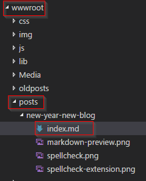
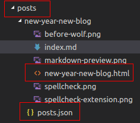

# wolf

[](https://github.com/z1c0/wolf/actions/workflows/ci.yml)
[](https://www.nuget.org/packages/wolf/)

```
/\_/\  wolf
|` ´|
 \-/   markdown to static blog post generator
```

**wolf** is a small and simple *Markdown* to *HTML static content* conversion 
tool.

It tries to follow the *Unix Tools Philosophy* of *"doing just one thing
and doing it well"*. Therefore, all it does is reading *Markdown* files
and spitting out *HTML* files. Nothing more, nothing less. No integrated web server,
no project template, just static content generation.

## Usage (CLI)

Typically, you run the *wolf* executable inside the **wwwroot** folder of your web application.
By default, *wolf* looks for a folder called **posts** that contains the
subfolders with the individual blog posts. Such a subfolder's name also acts as the
**slug** (URL route) of the blog post. A matching* *Markdown (.md)* file
in this folder will be converted to HTML.

*) "*Matching*" means an *.md* file named "index.md", "default.md", "post.md" or "<FOLDER_NAME>.md".

Of course, your mileage may vary and you are probably using *different folder
names* in your project. These are the command line options to change the default behavior.

```
Usage: wolf [options]

Options:
  -i, --inputDirectory <directory>   Input directory of blog posts [default: posts]
  -o, --outputDirectory <directory>  Output directory of blog posts (default: input directory)
  -nx, --noIndex                     Do not generate index (posts.json)
  -x, --indexDirectory <directory>   Directory where index (posts.json) file is written (default: output directory)
  -p, --imagePrefix <prefix>         Prefix added to image paths (default: /<output directory>/)
  -t, --tagFile                      Generate 'tags.json' file
  -v, --verbose                      Show detailed output
  -n, --nologo                       Do not display logo
  -?, -h, --help                     Show help and usage information
  --version                          Show version information
```

*wolf* exits with a non-zero code if any post fails to convert. In that case
`posts.json` is left untouched, so a broken post can't silently disappear
from the index.

So this is how the **posts** folder looks *before* running the *wolf* conversion.



This is *after* the *wolf* conversion.



As we can see, we now have an additional `.html` file per blog post as well
as a `posts.json` file containing the metadata for all blog posts.

```json
[
  {
    "slug": "new-year-new-blog",
    "title": "New Year, New Blog",
    "published": "2017-01-18T18:00:00",
    "tags": [
      "Blogging",
      "ASP.NET",
      "DotNetCore",
      "Linux",
      "Orchard",
      "Markdown"
    ]
  },
  {
    . . .
  }
]
```

This JSON file can easily be parsed in the web application to get a list of
available blog posts.

You can reuse the `Post` class from this project for that.

Deserialization can then be as simple as that:

```csharp
public class PostRepositoryLoader
{
  public JsonRepositoryLoader(string fileName)
  {
    _fileName = fileName;  // path to "posts.json"
  }

  public List<Post> Load()
  {
    return JsonConvert.DeserializeObject<List<Post>>(File.ReadAllText(_fileName));
  }
}
```

## Usage (API)

The *wolf* API provides basically the same functionality as the CLI version.
Create an instance of `Wolf.Convert` and provide a `Wolf.Config` object as its
argument.

The `Config` object is mandatory since you should at least decide whether errors
(e.g. an incorrect or non-existent directory path) should throw exceptions are not. By default
they do not.

```csharp
var converter = new Wolf.Converter(new Wolf.Config
{
  ThrowOnError = true,
});
```

Then simply start the conversion by calling the `Run` method.

```csharp
converter.Run();
```

The `Run` method returns a `Wolf.Result` object that provides further
information about the conversion operation.

```csharp
var result = converter.Run();
// Then use ...
result.Errors;
result.Warnings;
result.Information;
```

## NuGet

[](https://www.nuget.org/packages/wolf/)

[https://www.nuget.org/packages/wolf](https://www.nuget.org/packages/wolf/)

## Dependencies

**wolf** uses [Markdig](https://github.com/lunet-io/markdig) for the actual
*Markdown* to *HTML* conversion.

## Development

```
dotnet test --solution wolf.sln
```

The tests in `wolf.Tests` cover the conversion, the index, image handling and the
command line. `SamplePostsTests` converts the sample posts in `posts/` and
compares the result with `wolf.Tests/Expected`, which catches unintended output
changes (e.g. from a Markdig update). After an intended change, regenerate the
expected files with `WOLF_UPDATE_EXPECTED=1 dotnet test --solution wolf.sln`
and review the diff.

## Releasing

GitHub Actions (`.github/workflows/ci.yml`) runs the tests on every push and pull
request. On `main` it also publishes to NuGet when `<VersionPrefix>` in
`wolf.csproj` is a version that isn't on nuget.org yet, so bumping the version is
the release. Publishing uses NuGet Trusted Publishing (no API key in the repo).
